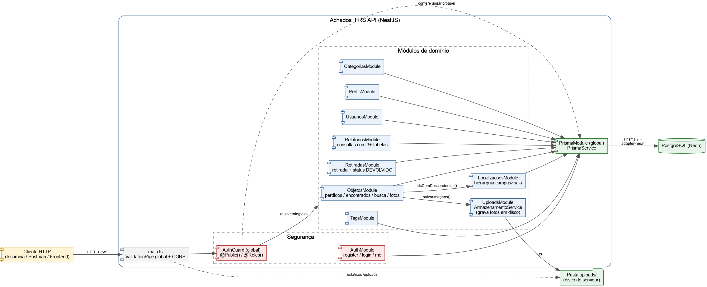
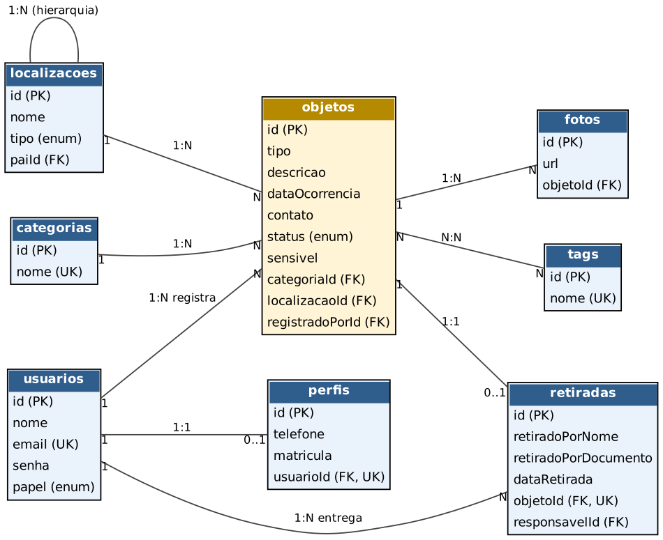

# Achados IFRS - Entrega de Implementação (Engenharia de Software I)

**Instituto Federal do Rio Grande do Sul - Campus Rio Grande · Turma I3**
**Professora:** Beatriz Conceição da Costa
**Integrantes:** Bruno Fagundes Garcia · Cristian Ferreira Vaz · Yago Sotter Caçoilo

**Links:** Repositório: https://github.com/brunofagundesdev/achados-ifrs · Quadro Kanban: https://github.com/users/brunofagundesdev/projects/4/views/2 · Protótipo: https://canva.link/a9mewj2mf7q8kcs

> Versão em PDF com as figuras: `Achados-IFRS-Entrega-Implementacao.pdf`. Testes e prints executados em 24/11/2026.

---

## 1. Implementação / protótipo funcional

Foi implementado o **backend completo** (API REST em NestJS + Prisma 7 + PostgreSQL/Neon), cobrindo as funcionalidades de prioridade Alta do backlog e parte das de prioridade Média. O **fluxo principal (HU01)** funciona de ponta a ponta: cadastro → login → cadastro de objeto perdido com local hierárquico e foto → confirmação com status "Perdido". Também funcionam o fluxo de objeto encontrado (HU03), a consulta/busca (HU02) e a retirada (HU04).

### 1.1 Requisitos atendidos

| Requisito | Como foi implementado | Rotas |
|---|---|---|
| RF01 - cadastro e autenticação | Senha com bcrypt, login devolve JWT (1h) | `POST /auth/register`, `POST /auth/login` |
| RF02 - acesso por perfil | Guard global + `@Roles()`; papéis USUARIO, RESPONSAVEL, ADMINISTRADOR | todas; `PATCH /usuarios/:id/papel` |
| RF03 - objeto perdido | Qualquer usuário autenticado; status inicial `PERDIDO`; contato obrigatório | `POST /objetos/perdidos` |
| RF04 - objeto encontrado | Somente responsável/administrador; status `ENCONTRADO` | `POST /objetos/encontrados` |
| RF05 - fotografias | Fotos anexadas ao registro (por URL da imagem) | `POST/DELETE /objetos/:id/fotos` |
| RF06 - consulta e busca | Filtros por tipo, categoria, descrição, localização, data, status e característica | `GET /objetos` |
| RF07 - localização hierárquica | Campus > prédio > andar > sala, validada no backend | `/localizacoes`, `/localizacoes/arvore` |
| RF08 - atualizar dados e status | Equipe altera tudo; dono corrige os próprios dados | `PATCH /objetos/:id` |
| RF09 - registrar retirada | Objeto, pessoa que retirou, responsável pela entrega (usuário logado) e data | `POST /retiradas` |
| RF10 - ocultar foto sensível | Fotos de objeto `sensivel` não aparecem para usuário comum | `GET /objetos`, `GET /objetos/:id` |
| RNF01 - autenticação obrigatória | `AuthGuard` global: toda rota exige token (exceto login/cadastro) | - |

### 1.2 Histórias de usuário e critérios de aceitação

| História / critério | Resultado |
|---|---|
| HU01 - autenticado cadastra objeto → status "Perdido" | Atendido (T16) |
| HU01 - campo obrigatório faltando → informa pendência | Atendido, resposta 400 com as mensagens de validação (T17) |
| HU01 - cadastro concluído fica disponível para consulta | Atendido (T22) |
| HU02 - busca por características retorna registros compatíveis | Atendido (T22, T23, T24) |
| HU02 - objeto sensível aparece sem fotografia | Atendido (T26) |
| HU03 - responsável/admin cadastra encontrado | Atendido (T21) |
| HU03 - usuário sem perfil autorizado é impedido | Atendido, 403 (T20) |
| HU04 - retirada informa objeto, pessoa, responsável e data | Atendido (T39) |
| HU04 - confirmação atualiza o status para "Devolvido" | Atendido (T40) |
| HU04 - informações da retirada associadas ao objeto | Atendido (T40) |

> Os códigos T.. referem-se aos cenários da tabela de testes (seção 3).

### 1.3 Evidências
Requisições reais à API em execução (24/11/2026), em `docs/evidencias/`:

| Figura | O que mostra |
|---|---|
| [01-login.png](evidencias/01-login.png) | Senha incorreta (401) e login válido com token JWT (RF01) |
| [02-cadastro-perdido.png](evidencias/02-cadastro-perdido.png) | HU01: cadastro com pendências (400) e cadastro completo com status PERDIDO (201) |
| [03-busca-sensivel.png](evidencias/03-busca-sensivel.png) | HU02: busca por "garrafa" e objeto sensível sem fotos para usuário comum (RF06, RF10) |
| [04-encontrado.png](evidencias/04-encontrado.png) | HU03: usuário comum bloqueado (403) e responsável cadastra encontrado (201) |
| [05-retirada.png](evidencias/05-retirada.png) | HU04: retirada registrada e objeto DEVOLVIDO com a retirada associada |
| [06-dashboard.png](evidencias/06-dashboard.png) | Dashboard da equipe com totais |
| [07-banco.png](evidencias/07-banco.png) | Tabelas criadas pela migração e registros gravados |
| [08-testes.png](evidencias/08-testes.png) | Saída do `npm test` (18/18) e do `npm run smoke` (51/51) |

Repositório: https://github.com/brunofagundesdev/achados-ifrs

---

## 2. Arquitetura e organização do código

### 2.1 Diagrama de componentes UML

### 2.2 Responsabilidades
A API segue a organização em módulos do NestJS: **cada funcionalidade tem seu módulo** (module + controller + service + DTOs), sem concentrar responsabilidades em um único arquivo.

| Componente | Responsabilidade |
|---|---|
| `AuthModule` + `AuthGuard` | Cadastro, login, validação do JWT e verificação de papel em toda requisição |
| `UsuariosModule`, `PerfisModule` | Gestão de usuários, troca de papel e perfil 1:1 |
| `CategoriasModule`, `TagsModule` | Classificação e características dos objetos |
| `LocalizacoesModule` | Hierarquia campus > prédio > andar > sala e sua validação |
| `ObjetosModule` | Cadastro de perdidos/encontrados, busca, fotos, status, regra de foto sensível |
| `RetiradasModule` | Registro de retirada e mudança de status em transação |
| `RelatoriosModule` | Consultas que combinam 3 ou mais tabelas e dashboard |
| `PrismaModule` | Único ponto de acesso ao banco (`PrismaService` injetado nos services) |

Camadas: **controller** (recebe a requisição e declara permissões) → **service** (regras de negócio e erros HTTP) → **PrismaService** (banco). A validação de entrada fica nos **DTOs** (class-validator).

### 2.3 Modelo de dados

---

## 3. Testes e validação

Três níveis de teste:

1. **Testes unitários** (`npm test`): regras de negócio da retirada, hierarquia de localizações, fotos sensíveis e permissões de edição, com o banco simulado.
2. **Testes de ponta a ponta** (`npm run smoke`): 51 cenários executados contra a API real; a tabela abaixo é gerada automaticamente em `docs/resultado-testes.md`.
3. **Testes manuais** no Insomnia/Postman (prints na seção 1.3).

### 3.1 Tabela de resultados
Execução de 24/11/2026 (Node.js 24.22.1, PostgreSQL 17.12 local; para rodar fora do Neon o adapter foi trocado temporariamente para `@prisma/adapter-pg` só no ambiente de teste).

- **Testes unitários (`npm test`): 18/18 aprovados** em 3 arquivos (localizações, retiradas, objetos).
- **Ponta a ponta (`npm run smoke`): 51/51 cenários com sucesso.** Tabela completa (cenário, esperado, obtido, situação) em [`resultado-testes.md`](resultado-testes.md).

Na primeira execução o T49 apareceu como falha; era um erro no próprio script de teste (seção 4.3). Após a correção, 51/51.

Cenários cobertos (esperado definido antes da execução): autenticação (T01-T08), categorias/tags/localizações (T09-T15), cadastro de objetos (T16-T21), busca e foto sensível (T22-T30), atualização (T31-T35), retiradas (T36-T43), perfis (T44-T45), exclusões protegidas (T46-T48) e relatórios (T49-T51).

---

## 4. Ajustes e evolução

### 4.1 Principais alterações desde a entrega anterior
- A entrega anterior (requisitos, histórias, protótipo, UML e planejamento) virou código: modelo de dados, API e autenticação.
- Os requisitos RF01 a RF10 foram traduzidos em módulos e rotas (tabela 1.1).
- O diagrama de componentes foi criado a partir da organização real dos módulos.

### 4.2 Decisões tomadas durante o desenvolvimento
- **Papel lido do banco, não do token:** assim, mudar o papel de alguém ou excluí-lo vale imediatamente.
- **Primeiro usuário vira administrador:** resolve o problema de "quem promove o primeiro responsável" sem precisar de script externo.
- **"Tipo" do objeto = o que ele é; "categoria" = o agrupamento:** o documento de requisitos lista os dois campos separadamente.
- **Localização hierárquica por auto-relacionamento:** uma única tabela representa campus, prédio, andar e sala; o backend impede combinações inválidas.
- **Retirada em transação:** registrar a retirada e marcar o objeto como "Devolvido" acontecem juntos ou não acontecem.
- **Fotos por URL:** o registro guarda o endereço da imagem; upload de arquivo ficou como evolução.
- **Dados pessoais da retirada** são visíveis só para a equipe.

### 4.3 Problemas encontrados e correções
| Problema | Causa | Correção / decisão |
|---|---|---|
| T49 reportado como falha, embora a API respondesse 200 com os dados corretos | A checagem extra do script devolvia o texto do caminho, e o script só aceita `true` | Checagem convertida para booleano em `scripts/smoke-test.mjs`; nova execução 51/51 |
| `npm install` não executou os scripts do bcrypt e do Prisma | npm recente bloqueia scripts de instalação por padrão | `npm install-scripts approve` + `npm rebuild`; documentado no README |
| Client do Prisma ausente após a migração | No Prisma 7, `migrate dev` não gera o client | `npx prisma generate` após migrar; documentado no README |
| API não conectava a PostgreSQL local | `@prisma/adapter-neon` só conecta ao Neon | Testes locais com `@prisma/adapter-pg` temporário; código entregue segue com Neon |
| Mensagens de validação em inglês ("contato should not be empty") | Mensagens padrão do class-validator | Pendente: traduzir as mensagens dos DTOs (backlog) |
| Comando de clonagem do README com endereço genérico | Link do repositório não preenchido | README atualizado com o repositório do grupo |

---

## 5. Atualização do planejamento

### 5.1 Backlog e situação

| Prioridade | Tarefa | Responsável | Situação |
|---|---|---|---|
| Alta | Cadastro e autenticação de usuários | Bruno | Concluída |
| Alta | Controle de acesso por perfil | Bruno | Concluída |
| Alta | Cadastro de objetos perdidos | Cristian | Concluída |
| Alta | Cadastro de objetos encontrados | Cristian | Concluída |
| Alta | Consulta e busca de objetos | Cristian | Concluída |
| Alta | Atualização de status e registro de retirada | Bruno | Concluída |
| Média | Cadastro hierárquico de localizações | Yago | Concluída |
| Média | Fotografias respeitando objetos sensíveis | Cristian | Concluída (por URL); upload de arquivo pendente |
| Média | Telas de administração de usuários e permissões | Bruno | Pendente (API pronta; falta interface) |
| Média | Testes dos fluxos principais e correções | Yago | Concluída (18/18 unitários, 51/51 ponta a ponta) |
| Alta | Interface web seguindo o protótipo | Cristian | Pendente |
| Baixa | Mensagens de validação em português | Yago | Pendente |
| Baixa | Upload de arquivo de foto e paginação da busca | Cristian | Pendente |

### 5.2 Próximos passos
Interface web conforme o protótipo do Canva, upload de arquivo de foto, telas de administração e busca com paginação.
